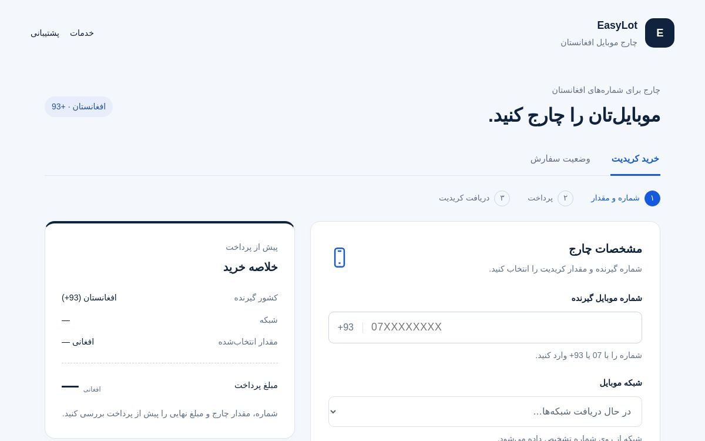

# EasyLot — نمونه‌کار عمومی ایزی‌لات

**سیستم خرید کریدیت موبایل افغانستان با پرداخت ارز دیجیتال و قیمت‌گذاری به افغانی.**

صاحب پروژه: [رضوان‌الله مؤحد](https://github.com/rizwanullahmuahed2-ui)

[معرفی انگلیسی](README.md) · [دیدن سایت](https://afghan-topup.rizwanullahmuahed2.chatgpt.site/)

## هدف پروژه

مشتری شمارهٔ موبایل افغانستان و مقدار چارج را وارد می‌کند، مبلغ نهایی را به افغانی می‌بیند و از طریق Heleket با ارز دیجیتال پرداخت می‌کند. پس از تأیید مستقل پرداخت در سرور، درخواست چارج از طریق API ریلودلی ارسال می‌شود.

ادمین نرخ روزانهٔ دالر و کارمزد را دستی تنظیم می‌کند. مبلغ و نرخ سفارش ثبت‌شده حفظ می‌شود؛ تغییر نرخ روزانه، سفارش قبلی را تغییر نمی‌دهد. چارج دستی ادمین جریان جداگانه‌ای دارد و به پرداخت مشتری وابسته نیست.

## تصویر رابط مشتری

تصویر واقعی از فرم خالی سایت است؛ فهرست شبکه‌ها در حال دریافت است و شماره یا معلومات سفارش مشتری در آن وجود ندارد.

## امکانات و مهارت‌های قابل بررسی

- طراحی دری، راست‌به‌چپ و مناسب موبایل.
- بررسی شماره و تشخیص شبکهٔ افغانستان در مرورگر و سرور.
- اتصال به دو API مستقل برای پرداخت و چارج.
- بررسی امضای پیام پرداخت و استعلام مستقل قبل از ارسال چارج.
- قیمت‌گذاری به افغانی و نگهداری نرخ هر سفارش.
- کنترل دسترسی ادمین، نشست امن و محدودیت تلاش‌های ورود.
- ثبت وضعیت سفارش و جلوگیری از ارسال هم‌زمان دوبارهٔ همان درخواست.
- بررسی نتیجهٔ نامعلوم به‌جای ارسال خودکار دوباره.
- ساختار دیتابیس و تغییرات نسخه‌بندی‌شده با Drizzle.

## اعتبارسنجی

در **۱۰ اکتوبر ۲۰۲۶**، نسخهٔ کد با **۳۳ تست خودکار شبیه‌سازی‌شده** و ساخت موفق Worker بررسی شد. تست‌ها پول مصرف نکردند و به شمارهٔ واقعی چارج نفرستادند.

این نسخه روی معماری Cloudflare Workers و D1 ساخته شده است. انتقال به VPS، اتصال نقدینه، صف بادوام ارسال و رزرو موجودی بین سفارش‌های متفاوت هنوز تکمیل نشده‌اند؛ بازپرداخت به‌صورت دستی رسیدگی می‌شود.

## برای کارفرما

این ریپو توضیح، معماری و تصویر پروژه را ارائه می‌کند. کد کامل، تست‌ها و راهنمای نصب برای بررسی فنی در ریپوی خصوصی نگهداری می‌شوند؛ دسترسی آن را می‌توان از صاحب پروژه درخواست کرد.

معرفی کامل انگلیسی در [README](README.md) و جزئیات تصمیم‌های فنی در [Project Overview](docs/PROJECT_OVERVIEW.md) آمده است.
