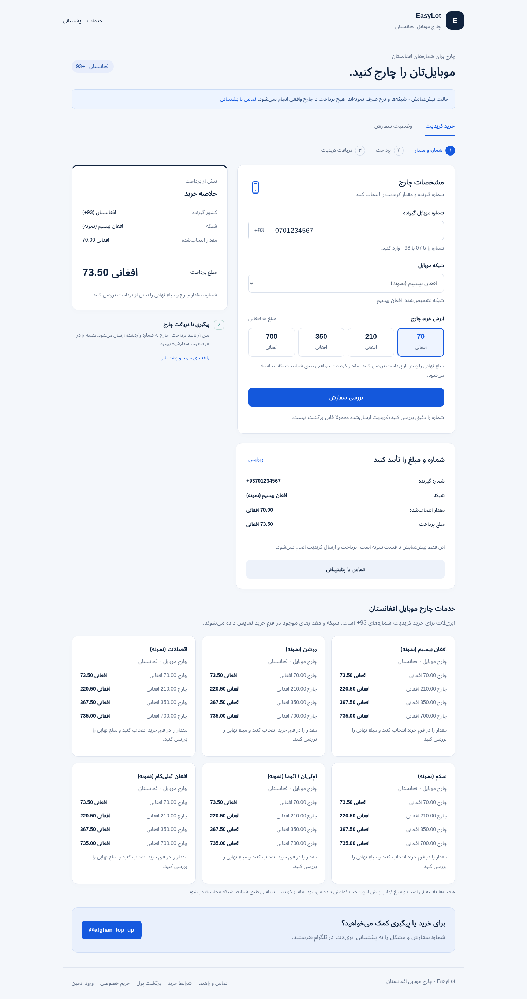
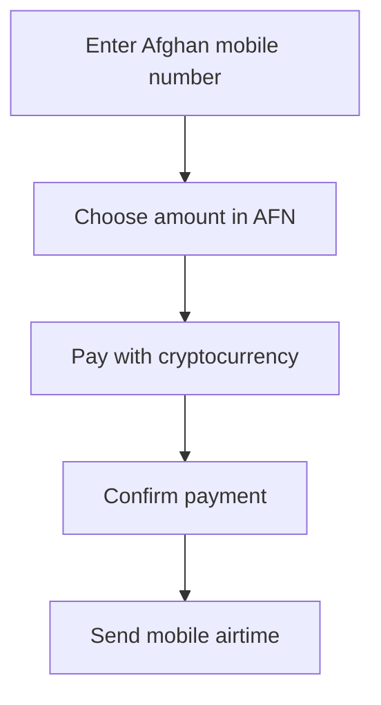

# EasyLot — Afghanistan Mobile Top-Ups

**A Dari web application connecting cryptocurrency payments to prepaid mobile airtime delivery in Afghanistan.**

**Project owner:** [Rizwanullah Muahed](https://github.com/rizwanullahmuahed2-ui)  
**Portfolio:** customer experience, API integration, payment verification, order processing and administration.

[Live website](https://afghan-topup.rizwanullahmuahed2.chatgpt.site/) · [راهنمای دری](README.fa.md) · [Project overview](docs/PROJECT_OVERVIEW.md) · [Browser case study](index.html)

This public repository presents the project for employers and technical reviewers. The complete implementation is maintained separately for private review; an employer can request repository access from the project owner.

## The problem

Customers need a simple way to buy airtime for Afghan phone numbers while paying with cryptocurrency. The storefront needs to speak Dari, display amounts in Afghanis, validate the mobile network, and coordinate payment confirmation with a separate prefunded airtime provider.

## The application

EasyLot supports cryptocurrency payments and mobile airtime delivery. Customers enter a number, choose an AFN amount, review the total, and continue to payment. The server independently verifies a settled payment before requesting airtime.

An administrator manages the daily AFN-per-USD rate and service markup. The customer sees the selected amount and final total, while provider requests and payment invoices remain denominated in USD. Existing orders retain their accepted pricing when settings change.

## Customer interface



*Local disconnected preview with a sample number and sample pricing. The reviewer can inspect an amount and quote without an invoice, payment or airtime delivery. The earlier hosted-site entry capture remains in `assets/customer-interface.png`.*

## Features implemented

| Area | Capability |
| --- | --- |
| Customer experience | Responsive, right-to-left Dari interface and AFN amounts |
| Phone validation | Afghan-number normalization, prefix-based network detection and server validation |
| Service catalog | Supported mobile networks, denominations and available-balance checks |
| Pricing | Admin-managed exchange rate and markup; order pricing snapshots |
| Payments | Cryptocurrency checkout and server-side payment verification |
| Order handling | Persistent states, private tracking access and atomic fulfillment claims |
| Administration | Password login, protected sessions, pricing controls and manual top-ups |
| Customer information | Support, purchase terms, refunds and privacy pages |

## High-level architecture



## Engineering decisions

- **Verify before delivery:** a payment-page return is not enough; the server checks the payment provider independently.
- **Preserve accepted prices:** orders save a pricing snapshot so daily rate changes do not rewrite an existing purchase.
- **Control concurrent sends:** a persisted atomic claim prevents simultaneous requests from dispatching the same stored top-up twice.
- **Review ambiguous results:** a provider timeout does not prove delivery failed; unclear outcomes require reconciliation rather than blind resending.
- **Keep operations distinct:** customer purchases and administrator manual top-ups have separate authorization and records.

## Technology and validation

| Component | Technology |
| --- | --- |
| Interface | HTML, CSS, JavaScript modules |
| Backend | Worker-compatible JavaScript, Fetch API and Web Crypto |
| Hosted database | Cloudflare D1 |
| Schema management | Drizzle and versioned SQL migrations |
| Development / tests | Node.js 24 and isolated SQLite databases |
| Integrations | Cryptocurrency payments and mobile airtime services |

On **21 October 2026**, the refreshed source passed **35 mocked automated tests** covering payment matching, callbacks, pricing, authentication, network validation, concurrent dispatch and ambiguous results. The Worker build and bundled-preview smoke check also completed successfully. Browser checks covered number detection, amount selection, quote review and the hidden payment action in preview. These checks did not spend provider funds or send real airtime.

The implementation is hosted and integrates the provider APIs. Production VPS migration and additional local integrations remain future work. Refunds are handled operationally; a durable delivery queue and cross-order wallet reservations are not included. These limits matter when assessing production scale.

## Reviewing the project

- Browse the [project overview](docs/PROJECT_OVERVIEW.md) for the workflow, design decisions and current scope.
- Visit the [live customer interface](https://afghan-topup.rizwanullahmuahed2.chatgpt.site/) to inspect the public user experience. A payment is not necessary to review the interface.
- Request private source access from the project owner for code, tests, migrations and installation instructions.

Source access is granted individually for technical review. This repository does not grant a license to the private implementation.

## Browse this case study locally

The repository includes a responsive static case-study page with expandable engineering decisions. From this directory:

```sh
python -m http.server 8082
```

Open `http://localhost:8082`. This serves documentation only and makes no payment requests. It does not deploy or change the hosted storefront.

## More portfolio projects

These projects have their own public repositories, setup guides, tests and dashboards:

- [Packet Trail — offline network capture analysis](https://github.com/rizwanullahmuahed2-ui/packet-trail): bounded PCAP parser, local dashboard, evidence-based traffic heuristics and CLI.
- [Bike Demand Lab — reproducible Machine Learning](https://github.com/rizwanullahmuahed2-ui/bike-demand-lab): chronological UCI benchmark, leakage checks, measured metrics and an evidence dashboard.
