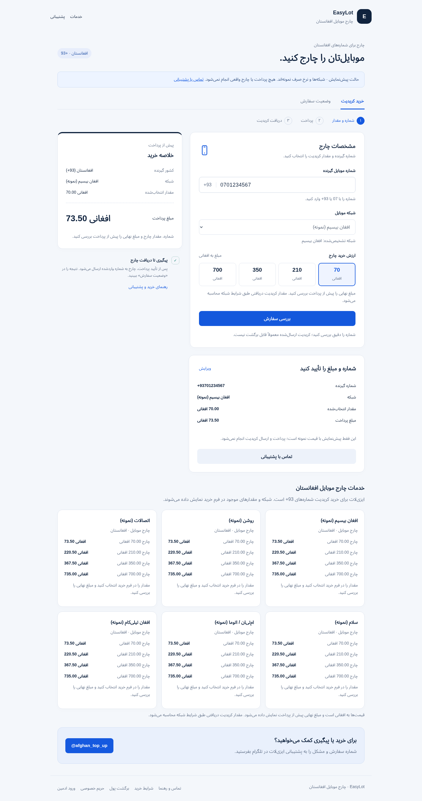

# EasyLot

A Dari storefront for buying mobile airtime in Afghanistan. The customer enters a number and an amount in AFN, checks the price, and pays through Heleket. The backend verifies the payment before requesting airtime from Reloadly.

[Customer interface](https://afghan-topup.rizwanullahmuahed2.chatgpt.site/) · [معرفی به دری](README.fa.md) · [Technical overview](docs/PROJECT_OVERVIEW.md) · [Browser case study](index.html)

[About me and my other projects](PORTFOLIO.md)



The screenshot uses a sample number and price in the disconnected local preview. It does not show a real payment or delivery.

## Work worth looking at

- Afghan phone-number validation and a mobile-friendly, right-to-left interface.
- Admin-managed exchange rates and fees, with the accepted price saved on each order.
- Signed payment callbacks and an independent lookup of the invoice, currency and amount.
- A database claim before fulfillment, so concurrent requests cannot send the same stored order twice.
- A review state for provider timeouts: an unclear response is investigated before resending.
- Private order tracking, admin sessions and versioned database migrations.

The source uses JavaScript, Cloudflare Workers/D1 and Drizzle. Its Node.js preview uses SQLite. The [technical overview](docs/PROJECT_OVERVIEW.md) explains the order states and integration decisions.

## Review and current scope

This public repository contains the case study and screenshots. The implementation is in a private repository; [contact me](mailto:rizwanullahmuahed2@gmail.com) for source access.

The 21 October 2026 source check passed 35 automated tests with mocked providers and a Worker build. No payment or airtime was sent by those checks. Refunds are handled manually. A durable delivery queue, cross-order balance reservations and a production VPS adapter are still outstanding.

To open the static case study locally:

```sh
python -m http.server 8082
```

Visit http://localhost:8082. This page makes no payment requests.

## Other projects

- [Packet Trail](https://github.com/rizwanullahmuahed2-ui/packet-trail): offline PCAP inspection with a dashboard and CLI.
- [Bike Demand Lab](https://github.com/rizwanullahmuahed2-ui/bike-demand-lab): hourly prediction with chronological evaluation.
