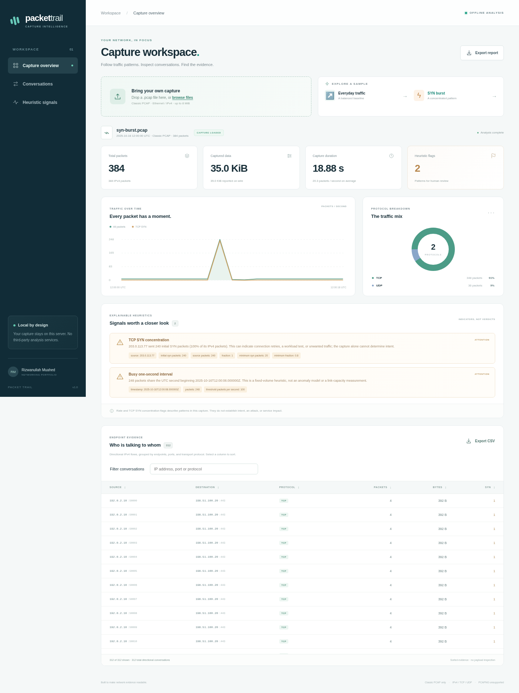

# Packet Trail

Open a small packet capture and see what happened: which protocols were present, which endpoints talked, when traffic increased, and which records need a closer look.

Packet Trail is a local FastAPI application with a browser dashboard and a command-line interface. It reads **classic Ethernet PCAP** files offline. It does not capture live traffic or send probes. Two bundled synthetic captures let you try the full interface without collecting network data.



## Start locally

Python 3.11 or newer:

```sh
python -m venv .venv
# macOS/Linux: source .venv/bin/activate
# Windows: .venv\Scripts\activate
python -m pip install -e ".[dev]"
uvicorn packet_trail.app:app --host 127.0.0.1 --port 8080
```

Visit **http://127.0.0.1:8080**. Choose *Steady conversations* first, then *A concentrated SYN burst*. The baseline contains 144 packets; the second fixture adds 240 initial SYN packets in one second. The dashboard shows the measurements behind each flag, with protocol distribution, a time chart, searchable/sortable directional conversations and JSON/CSV export.

## CLI

```sh
packet-trail packet_trail/samples/normal.pcap -o report.json
packet-trail packet_trail/samples/syn-burst.pcap --format csv -o conversations.csv
python -m packet_trail.fixtures
python -m pytest -q
ruff check packet_trail tests
```

The fixture generator constructs deterministic bytes using documentation-only IP ranges. It never opens a network socket. CLI errors return exit status 2.

## What is parsed

- Classic PCAP 2.4, little/big endian, microsecond/nanosecond timestamp formats.
- Ethernet, up to two VLAN tags, IPv4, TCP and UDP headers, plus basic ICMP counts.
- Per-frame truncation, malformed-header and unsupported-protocol evidence.
- Captured bytes and original wire lengths are reported separately. Conversations are **directional** IP/port tuples, not reconstructed sessions.

PCAPNG, non-Ethernet link types, IPv6 transport decoding, payload inspection, stream reassembly and checksum verification are outside the current scope. Fragmented IPv4 is counted and labelled, without guessing transport ports. Timestamp formats are recognized, but aggregation uses floating-point seconds rather than preserving nanosecond arithmetic.

## How flags work

| Review prompt | Rule | What it cannot establish |
|---|---|---|
| TCP SYN concentration | A source has ≥20 SYN-without-ACK packets and they represent ≥80% of its valid IPv4 packets | Attack intent, completed handshakes, packet loss or service impact |
| Busy one-second interval | ≥100 captured packets within one absolute UTC second | A link-capacity threshold or a learned anomaly |

These fixed thresholds are transparent heuristics, not a trained intrusion detector. Retries, workload tests, NAT, sampling and incomplete captures can all change the interpretation. A flagged capture needs investigation; an unflagged one is not a security guarantee.

## Bounds and privacy

The analyzer accepts at most **8 MiB**, **50,000 packets** and **262,144 bytes per original frame**. Output is capped at 500 conversations, 100 issue details and 120 time bins; totals remain visible. Container corruption stops parsing instead of treating payload bytes as record headers.

Uploads are parsed in memory, not retained or sent to external services. Exports contain endpoint addresses and metadata, so treat them as sensitive if they came from a real network. Keep the server bound to loopback; this application does not include accounts, multi-user isolation or production rate limiting. Browser assets are local and use no analytics or external fonts.

## Structure

`parser.py` validates the container and decodes headers; `analysis.py` builds bounded evidence and heuristics; `app.py` handles in-memory uploads; `cli.py` exports the same report. The dashboard uses plain HTML/CSS/JavaScript, with accessible tables alongside charts. Tests cover byte orders, timestamp units, corrupt captures, bounds, truncation, heuristic evidence, uploads and CLI behavior.

The [research directory](research/README.md) records the status of the owner's separate, earlier DoS study. This newly built tool did not produce that study's results. Original code is MIT licensed; bundled captures are generated fixtures, not real traffic records.
